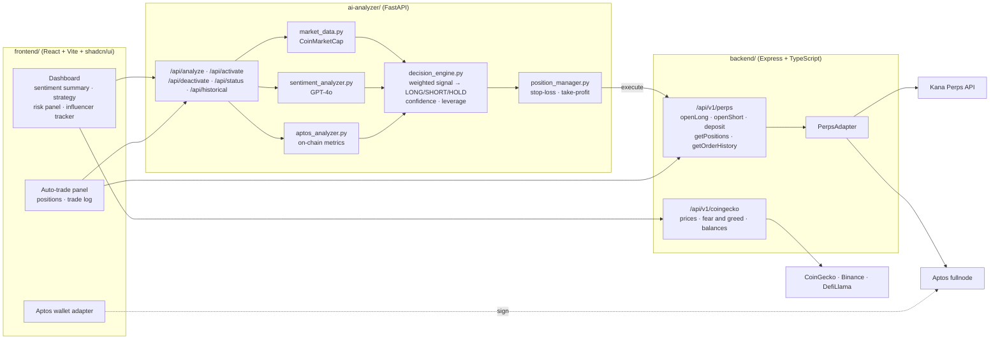

# AptosHack: Sentenex Sentiment Trader

### AI agent that reads market sentiment and trades perpetuals on Aptos


Sentenex combines live market data, GPT-4o sentiment analysis, and Aptos on-chain metrics into a **LONG / SHORT / HOLD** call with a confidence score and a suggested leverage. In auto-trade mode it opens and manages positions on [Kana Perps](https://kana.trade) for you, within the risk limits you set.

## Architecture



**Signal pipeline**

1. **Market data.** Price, volume, market cap, and 1h/24h/7d change from CoinMarketCap.
2. **Sentiment.** GPT-4o scores the news and social context for the token.
3. **On-chain.** Activity metrics from the Aptos chain.
4. **Decision engine.** Weights the three signals into a single score. It returns a recommendation, a confidence level, a suggested leverage, and an estimated PnL for the amount you entered.
5. **Execution.** Once you activate the agent, the position manager opens longs or shorts through the backend's Kana Perps adapter and enforces stop-loss and take-profit.

## Repository layout

| Folder | Stack | Role |
|---|---|---|
| [`frontend/`](frontend) | React, Vite, TypeScript, Tailwind, shadcn/ui, TanStack Query | Trading dashboard and wallet connection |
| [`backend/`](backend) | Node.js, Express, TypeScript, Aptos TS SDK | Perps execution on Kana, price and balance endpoints |
| [`ai-analyzer/`](ai-analyzer) | Python, FastAPI, OpenAI, httpx, Docker | Sentiment and on-chain analysis, decision engine |

Each folder has its own README with full setup steps.

## Quick start

```bash
git clone https://github.com/Devanshgoel-123/AptosHack.git && cd AptosHack

# 1. AI analyzer (port 8000)
cd ai-analyzer && pip install -r requirements.txt
cp env.example .env              # CMC_API_KEY, OPENAI_API_KEY
python app.py                    # or ./run-docker.sh

# 2. Backend (port 3000)
cd ../backend && npm install
cp .env.example .env             # APTOS_PRIVATE_KEY, PERPS_API_KEY, COINMARKETCAP_API_KEY
npm run dev

# 3. Frontend
cd ../frontend && npm install
npm run dev                      # set VITE_API_URL if the backend isn't on :3000
```

Interactive API docs for the analyzer are at `http://localhost:8000/docs`.

> ⚠️ This is a hackathon project and not financial advice. Use a dedicated test wallet with small amounts when running auto-trade.
